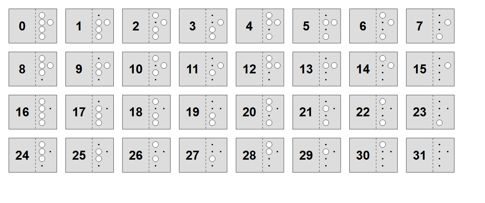

# TZe cassette identification

How a P-touch printer knows which tape is loaded, what it reports to WebLabelMaker,
and how to work out the hole pattern for a given colour so a third-party cassette can
be made to report correctly.

**Status of this document: the hole-to-colour table is not filled in.** A community
project has decoded seven cassettes on another printer (see
[What others have measured](#what-others-have-measured)), which is a start but not a
table, and it covers a different group of holes from the one the PT-E560BT reads.
What follows is what is established, the codes the printer reports, and a set of
numbered probe shims to map all 32 combinations on your own printer. The worksheet at
the end is where the real table goes once measured.

## What is established

- **The cassette is identified mechanically.** The printer has spring-loaded sense
  pins (switches). Each pin either drops into a hole in the cassette or is pushed in
  by plastic where there is no hole. The printer reads the combination.
- **There are several groups of holes on a TZe cassette:**
  - a group on the **bottom, in a corner**: the original TZ scheme, kept so TZe
    cassettes work in older TZ printers;
  - a group on the **bottom, in the middle**: added with TZe;
  - holes on the **side**, entered by pins that the cover lever pushes out when the
    lid closes.
- **Printers do not all read every hole.** A small printer (PT-1090, PT-D210) has
  fewer pins than a wide one (PT-P700 has more, for 24 mm tape). A cassette can carry
  information a given printer never looks at.
- **On an older three-switch printer (PT-H100 service manual), a closed hole means
  switch ON**, and the three switches together give tape width and cassette type
  (laminated, non-laminated, fabric). That manual says nothing about colour. Treat
  the polarity as likely but unconfirmed for the E560BT.
- **Which group carries colour is not documented by Brother.** Measurements on a
  PT-P300BT point to the bottom-middle group (see below). The PT-E560BT reads a
  different group, at the cassette's left edge, so the same information must also be
  encoded there; how is what remains to be mapped.

## What others have measured

[GoganGogan/Brother-TZe-Tapes](https://github.com/GoganGogan/Brother-TZe-Tapes), based
on JongHun Lee's Hackaday project on a PT-P300BT, names nine sense positions: `ABCD` on
the print-head side and `EFGHI` on the bottom, in the middle. `0` is an open hole, `1` a
closed one. Only seven cassettes have been filled in:

| Cassette | Tape | `ABCD` | `EFGHI` |
|---|---|---|---|
| TZe-241 | 18 mm, black on white | `0011` | `00101` |
| TZe-251 | 24 mm, black on white | `0001` | `00101` |
| TZe-FX251 | 24 mm flexible ID, black on white | `0001` | `00101` |
| TZe-651 | 24 mm, black on yellow | `0001` | `00110` |
| TZe-S641 | 18 mm strong adhesive, black on yellow | `1100` | `00110` |
| HSe-211 | 5.8 mm heat-shrink, black on white | `1000` | `00101` |
| HSe-241 | 17.7 mm heat-shrink, black on white | `0000` | `00101` |

What this suggests, with only two colours to compare:

- `ABCD` changes with width and tape type and not with colour.
- `EFGHI` is `00101` for every black-on-white cassette and `00110` for both
  black-on-yellow ones, so colour is in that group, at least in its last two positions.

That is on a PT-P300BT, reading the bottom-middle group. It does not say what the other
30 combinations mean, and it is not the group the E560BT reads.

## The PT-E560BT

Observed on the printer (by its owner, not from documentation): it has **five sense
pins** on the group of six holes at the cassette's left edge. That group is two columns:
four holes on the left, two on the right. The pins read the four left holes and the
lower of the two right holes; the upper right hole is not read.

Five pins give 32 combinations. The pin numbering used by the probe shims:

```
P1  .      left column, top       (. = not read)
P2  P5     left column / right column, lower hole
P3
P4         left column, bottom
```

Whether this group encodes colour alone, or colour together with something else, is
what the shims are for.

## Probe shims

[cassette-shims/tze-probe-shims.scad](cassette-shims/tze-probe-shims.scad) is an
OpenSCAD model of 32 numbered plates. Each plate leaves some of the five positions open
and closes the rest.



**Plate number = P1×1 + P2×2 + P3×4 + P4×8 + P5×16**, where 1 means *closed* (the pin is
pushed in). Plate 0 leaves all five open; plate 31 closes all five. The number is cut
into the handle.

Before printing the set:

1. **The dimensions in the file are estimates taken from a photograph.** Measure the
   hole pitch and diameter with calipers and correct `col_pitch`, `row_pitch`, `p5_row`
   and `open_d` at the top of the file.
2. **Check the fit on paper first.**
   [cassette-shims/tze-probe-shims.svg](cassette-shims/tze-probe-shims.svg) is the same
   set at 1:1. Print it at 100%, cut out plate 0 and lay it over the holes. It is
   generated from the default dimensions, so it only matches the model until you change them.
3. **Print one plate** (`only = 0`) and check that all five pins pass through it and the
   lid closes without force, then print the rest.

The base cassette matters:

- A plate can only **close** a position. To reach all 32 combinations the cassette
  under it must have all five positions **open**. No genuine cassette is likely to, so
  use an empty or sacrificial cassette and drill the five positions through.
- Keep everything else on that cassette as it is, so the printer still sees a valid
  width and type.
- The plate sits under the cassette and lifts it by its thickness (0.4 mm by default).
  That is fine for reading the status. Do not print labels with a plate fitted.

For each plate: fit it, close the lid, press **Refresh** in the printer panel, and write
down bytes 10, 11, 24 and 25 in the [probe table](#probe-table). Thirty-two readings
give the complete code for this printer. Remember the combination already on your
genuine cassettes: it tells you which plate number each known colour corresponds to and
is a check that the numbering is the right way round.

## Dummy cassette

[cassette-shims/tze-dummy-cassette.scad](cassette-shims/tze-dummy-cassette.scad) is a
stand-in for a cassette, so no real one has to be drilled. It is a base plate that seats
in the cassette bay with:

- a **pocket for each group of bottom pins**, taking a numbered card flush with the
  underside (the bay floor holds the card in; open pins rise through a window above it);
- an **upright holder in front of the side pins**, taking a card that slides in from above;
- **posts up to cassette height**, so the closed lid holds it down against the pins' springs.

It carries no tape and is only for reading what the printer reports.

**Every dimension in the file is a placeholder.** It will not fit as it is. Measure
these and enter them at the top of the file:

| What | Parameters |
|---|---|
| Cassette outline seen from below, and its height | `body_w`, `body_d`, `corner_r`, `cassette_h` |
| Spindles, rollers and posts in the bay: position and diameter | `clearances` |
| Where the print head and platen enter the cassette | `cutouts` |
| Each group of bottom pins: position of the first pin and the offsets of the others | `pockets` |
| Pin diameter plus clearance | `open_d` |
| Side pins: where they meet the cassette wall, their direction, and each pin's height | `side_at`, `side_angle`, `side_pin_z`, `side_pin_offset` |

Positions are measured from the lower-left corner of the cassette seen from below. A
flat, square-on photo of a cassette's underside next to a ruler, and one of the side
with the pin holes, is enough to take most of these from.

Parts to render (`part = …`): `base`, `bottom_set` (every card for the pocket chosen by
`pocket_index`), `side_set`, or a single `bottom_card` / `side_card` by `number`. Print
the base in draft first and correct it against the printer before printing cards.

Card numbers follow the same rule as the probe shims: bottom card = P1×1 + P2×2 + P3×4
+ P4×8 + P5×16, side card = A×1 + B×2 + C×4 + D×8, with 1 meaning closed.

Things that may stop it working, which only a trial will show:

- The printer may check for more than the sense pins before reporting a cassette, such
  as a lid switch or the tape itself.
- Width and tape type are read from pins too. With the dummy, those are whatever the
  cards say, so expect byte 10 and 11 to change along with the colour bytes.

## What the printer reports

After a status request the printer answers with 32 bytes. WebLabelMaker reads:

| Byte | Meaning |
|---|---|
| 10 | Tape width in mm (`0` = no cassette, `4` = 3.5 mm) |
| 11 | Tape type |
| 24 | Tape colour code |
| 25 | Text colour code |

The printer panel (top right) shows bytes 24 and 25 as hex, which is what you need
while testing.

### Tape colour codes (byte 24)

| Code | Tape | Code | Tape |
|---|---|---|---|
| `01` | White | `30` | Blue (D) |
| `02` | Other | `31` | Red (D) |
| `03` | Clear | `40` | Fluorescent orange |
| `04` | Red | `41` | Fluorescent yellow |
| `05` | Blue | `50` | Berry pink (S) |
| `06` | Yellow | `51` | Light gray (S) |
| `07` | Green | `52` | Lime green (S) |
| `08` | Black | `60` | Yellow (fabric) |
| `09` | Clear (white text) | `61` | Pink (fabric) |
| `20` | Matte white | `62` | Blue (fabric) |
| `21` | Matte clear | `70` | White heat-shrink tube |
| `22` | Matte silver | `90` | White flexible ID |
| `23` | Satin gold | `91` | Yellow flexible ID |
| `24` | Satin silver | `F0` | Cleaning |
| | | `F1` | Stencil |
| | | `FF` | Incompatible |

### Text colour codes (byte 25)

| Code | Text | Code | Text |
|---|---|---|---|
| `01` | White | `0A` | Gold |
| `02` | Other | `62` | Blue (fabric) |
| `04` | Red | `F0` | Cleaning |
| `05` | Blue | `F1` | Stencil |
| `08` | Black | `FF` | Incompatible |

These tables were written from memory of Brother's raster command reference for the
PT-P700 / E550W / P710BT families. Your PT-E560BT does report colour, so the bytes
are live, but **check the codes against cassettes you own** before trusting a row:
load a genuine cassette, read the two bytes in the printer panel, and compare.

A no-brand cassette that always reads `01` / `08` (white tape, black text) has the
hole pattern of a white/black cassette, whatever tape is inside.

## Mapping the hole pattern yourself

You need the printer, WebLabelMaker connected to it, a few **genuine** cassettes of
different colours in the **same width**, and opaque adhesive tape (Kapton or
electrical tape) to block holes.

1. **Number the holes.** Photograph the underside and side of one cassette. Mark
   every position where any of your cassettes has a hole, including positions that
   are solid plastic on this one. Number them and keep the photo as the key.
2. **Record each genuine cassette.** For each one, write down which numbered
   positions are open, then load it and note bytes 10, 24 and 25 from the printer
   panel (press Refresh). One row per cassette in the worksheet below.
3. **Find the colour positions by difference.** Two cassettes of the same width and
   type that differ only in colour differ only in colour holes. Positions that never
   change across your set are width, type or unused.
4. **Confirm by blocking.** Take one cassette, cover one open hole with tape, reload,
   Refresh, and note the bytes. Uncover it and repeat for the next hole. A hole whose
   blocking changes byte 24 belongs to tape colour; byte 25, text colour; byte 10,
   width. A hole that changes nothing is not read by this printer.
5. **Check the polarity.** Blocking a hole can only take you from "open" to
   "closed". To go the other way you would have to drill, so confirm the pattern for
   a target colour by blocking holes on a cassette that has more holes open than the
   target, not fewer.
6. **Design the shim from the measured table.** A shim can close holes (fill them);
   it cannot open ones that are not there. If the no-brand cassette has fewer open
   holes than the colour you want needs, the shim alone will not do it and the
   cassette shell must be drilled at the right positions instead.

Precautions:

- Do not force the lid. If a blocked hole stops the cassette seating, the tape is
  too thick; use thinner tape.
- Width and type holes also set the print energy and the pins used. Leave them
  exactly as on a genuine cassette of the tape actually inside, or prints will be
  misplaced or too light or dark.
- A pattern the printer does not recognise reports `FF` (incompatible) and the
  printer may refuse to print.

## Worksheet

Hole positions as numbered in your photo. `O` = open hole, `X` = solid.

| Cassette (part no.) | Width | Tape / text | 1 | 2 | 3 | 4 | 5 | 6 | 7 | 8 | 9 | 10 | Byte 10 | Byte 24 | Byte 25 |
|---|---|---|---|---|---|---|---|---|---|---|---|---|---|---|---|
| | | | | | | | | | | | | | | | |
| | | | | | | | | | | | | | | | |
| | | | | | | | | | | | | | | | |
| | | | | | | | | | | | | | | | |

Blocking test, one cassette:

| Hole blocked | Byte 10 | Byte 24 | Byte 25 | Conclusion |
|---|---|---|---|---|
| none | | | | baseline |
| 1 | | | | |
| 2 | | | | |
| 3 | | | | |

### Probe table

One row per probe shim. `C` = closed, `O` = open.

| Plate | P1 | P2 | P3 | P4 | P5 | Byte 10 | Byte 11 | Byte 24 | Byte 25 | Reads as |
|---|---|---|---|---|---|---|---|---|---|---|
| 0 | O | O | O | O | O | | | | | |
| 1 | C | O | O | O | O | | | | | |
| 2 | O | C | O | O | O | | | | | |
| 3 | C | C | O | O | O | | | | | |
| 4 | O | O | C | O | O | | | | | |
| 5 | C | O | C | O | O | | | | | |
| 6 | O | C | C | O | O | | | | | |
| 7 | C | C | C | O | O | | | | | |
| 8 | O | O | O | C | O | | | | | |
| 9 | C | O | O | C | O | | | | | |
| 10 | O | C | O | C | O | | | | | |
| 11 | C | C | O | C | O | | | | | |
| 12 | O | O | C | C | O | | | | | |
| 13 | C | O | C | C | O | | | | | |
| 14 | O | C | C | C | O | | | | | |
| 15 | C | C | C | C | O | | | | | |
| 16 | O | O | O | O | C | | | | | |
| 17 | C | O | O | O | C | | | | | |
| 18 | O | C | O | O | C | | | | | |
| 19 | C | C | O | O | C | | | | | |
| 20 | O | O | C | O | C | | | | | |
| 21 | C | O | C | O | C | | | | | |
| 22 | O | C | C | O | C | | | | | |
| 23 | C | C | C | O | C | | | | | |
| 24 | O | O | O | C | C | | | | | |
| 25 | C | O | O | C | C | | | | | |
| 26 | O | C | O | C | C | | | | | |
| 27 | C | C | O | C | C | | | | | |
| 28 | O | O | C | C | C | | | | | |
| 29 | C | O | C | C | C | | | | | |
| 30 | O | C | C | C | C | | | | | |
| 31 | C | C | C | C | C | | | | | |

Once the table is filled in, the colour codes can be written here properly and the
app's colour names checked against them.

## Sources

- [TZe carts have side pin holes](https://ptouchman.blogspot.com/2017/02/tze-carts-have-side-pin-holes-on.html):
  hole groups and their positions; no encoding table.
- [Cheapnified Brother TZ label cartridge](https://softsolder.com/2020/04/19/cheapnified-brother-tz-label-cartridge/):
  sense pins on a PT-1090; a commenter says they also carry width and print energy; no table.
- [Brother PT-H100 service manual, "Identification of tape cassette type"](https://www.manualslib.com/manual/1307233/Brother-Pt-H100.html?page=23):
  three switches, closed hole = switch on, width and cassette type only.
- [GoganGogan/Brother-TZe-Tapes](https://github.com/GoganGogan/Brother-TZe-Tapes):
  the seven decoded cassettes quoted above and a photo labelling the nine positions,
  based on [JongHun Lee's Hackaday project](https://hackaday.io/project/190126-brother-label-tape-hack)
  on a PT-P300BT. The Hackaday page itself could not be read when this was written.
