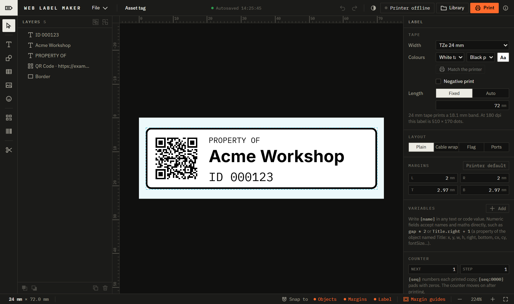
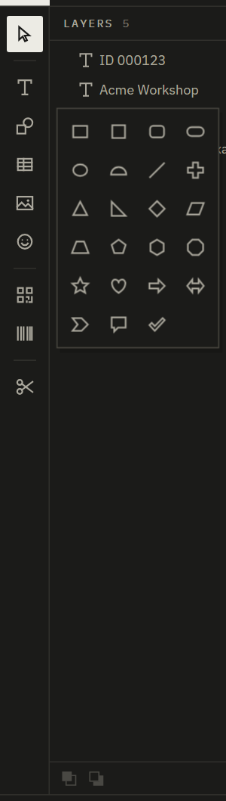
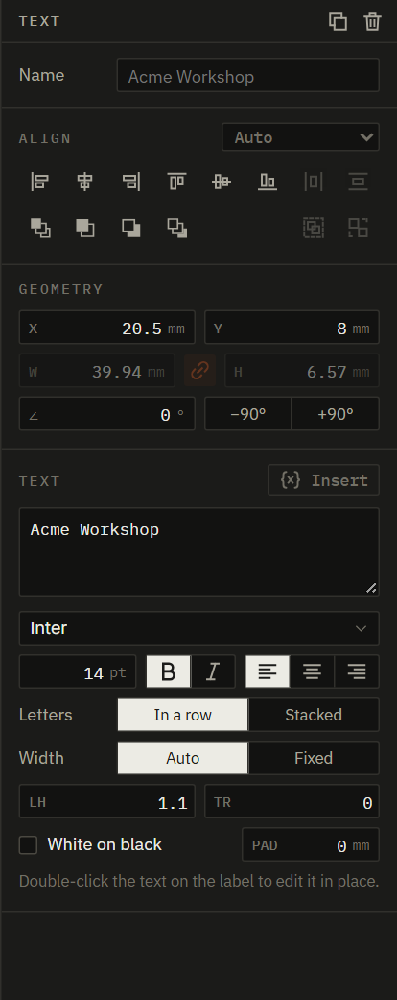
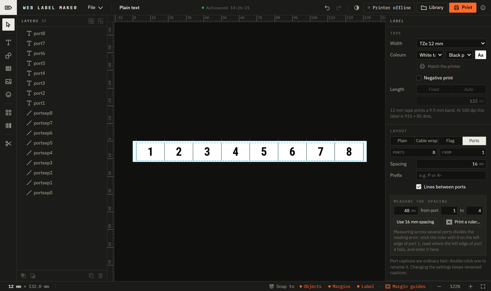

# Editor

The screen has four parts:

- **Left rail:** the tools.
- **Layers:** every object on the label, front-most first.
- **Canvas:** the label at the printer's proportions. The dashed line is the margin.
- **Right panel:** settings for the selected object, or for the label when nothing is selected.

## Adding objects

Pick a tool, then **click** on the label for a default size or **drag** to draw it. The
object is shown live while you drag. Esc cancels the tool.

| Tool | What it adds |
|---|---|
| Text | A text box. Click for a box that hugs the text; drag for a fixed-width box that wraps. |
| Shapes | Rectangles, ellipses, lines, arrows, polygons and more, from the flyout. Hold Shift to keep it square. |
| Table | Hover the grid to pick rows × columns, then place it. Tab and Enter move between cells. |
| Image | From a file or from your image library. You can also drop or paste a picture onto the label. |
| Icons | Search the open-source icon sets collected by Iconify. Icons are placed as vectors. |
| 2D code | QR Code, Data Matrix, Aztec, PDF417. |
| 1D barcode | Code 128, Code 39, EAN, UPC and others. |
| Cut mark | Click where the tape should be cut (full or half cut). |

## Editing objects

Select an object to see its settings on the right.

- **Name:** optional. Other objects can refer to a named object in expressions.
- **Geometry:** position, size and rotation in millimetres. The link button between W
  and H locks the proportions.
- **Text:** double-click a text on the label to type in it in place.
  - *Width* **Auto** makes the box follow the text; **Fixed** keeps the box and either
    breaks lines or scales the text to fit.
  - *Letters* **Stacked** puts upright letters one above the other.
- **Images** are converted to black and white at the printer's resolution. Choose the
  dither method and adjust threshold, brightness and contrast.
- **2D codes** can hold plain text, a URL, Wi-Fi settings, a contact card and more.

### Selecting, moving, arranging

- Click to select; Shift+click or drag a box around several objects to select many.
- Drag to move, or use the arrow keys (Shift for bigger steps).
- The **Align** section lines up or distributes the selection.
- Ctrl+G groups, Ctrl+Shift+G ungroups. Double-click a group to work inside it.
- Ctrl+] and Ctrl+[ move an object forward or backward. You can also drag rows in the Layers panel.
- Ctrl+Z / Ctrl+Y undo and redo. Ctrl+D duplicates.

### Snapping

Moving and resizing snap to nearby lines. The **Snap to** switches in the bottom bar
turn snapping on or off for other objects, the margins, and the label's edges and
centre. Hold Ctrl while dragging to bypass snapping.

## Label settings

Deselect everything (click an empty area or press Esc) to see the label's own settings.

- **Width:** the tape. Changing it on a label with content asks whether to scale the
  content or keep its sizes.
- **Colours:** tape and print colour, for the preview only. The printer prints on
  whatever tape is loaded.
- **Match the printer:** sets width and colours from the cassette in the printer.
- **Negative print:** prints the area inside the margins solid and leaves the content blank.
- **Length:** **Fixed**, or **Auto** to follow the content.
- **Margins:** *Printer default* matches the printer's unprintable area.

## Cabling layouts

Under **Layout** in the label settings:

- **Cable wrap:** set the cable diameter and repeat distance. Design the first cell;
  it repeats to cover the circumference.
- **Flag:** two faces either side of a fold. Side B can copy side A or be designed separately.
- **Ports:** a numbered strip. Set the number of ports, the first number and the
  spacing between left edges.
  - **Measure the spacing:** enter a distance measured across several ports and the app
    divides it for you. *Print a ruler…* makes a millimetre scale to stick on the panel.

In a layout the label length is computed for you.

## Cut marks

Use the scissors tool, or **Add** under *Cut marks* in the label settings, then drag the
mark's tab above the label. A full cut goes through tape and backing; a half cut leaves
the backing so the pieces stay together. The printer needs blank feed either side of a
cut, and the print preview shows what is lost.
