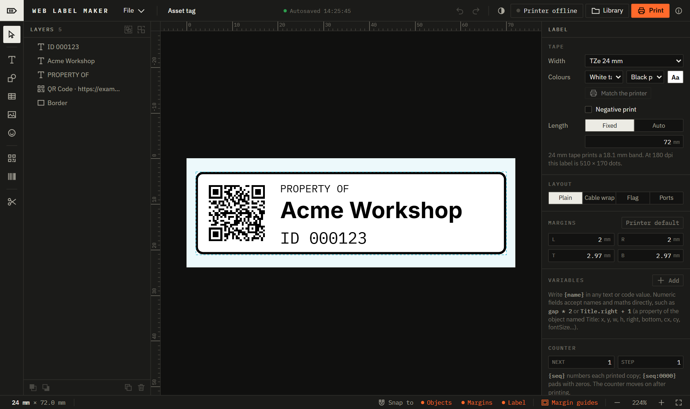

# WebLabelMaker

WebLabelMaker designs and prints labels for tape printers, entirely in the browser.
Open the app at <https://web-label-maker.remy-gr.workers.dev/>.

## Guides

- **[Editor](Editor)**: the tools, objects, layers, snapping, cabling layouts and cut marks.
- **[Variables](Variables)**: `{name}` macros, the counter, dates, and numeric fields driven by expressions.
- **[Library](Library)**: autosave, saved labels, templates, images, and import/export.
- **[Printing](Printing)**: connecting the printer, the status control, print options.

## Five-minute start

1. Pick the tape width in the **Label** panel on the right (shown when nothing is selected).
2. Choose a tool in the left rail, then click or drag on the label to place an object.
3. Select an object to edit it in the right panel. Double-click a text to type in it directly.
4. Click **Printer offline** in the top bar and choose the printer's serial (COM) port.
5. Press **Print**, check the preview, and print.

Your work is saved automatically in the browser as you go. Use **File → Save to
library** (Ctrl+S) to keep a named copy.

## What you need

- **To design:** any current desktop browser.
- **To print:** Chrome, Edge or Opera on a desktop computer. Printing uses Web Serial,
  which Firefox and Safari do not provide.
- **A supported printer:** Brother P-touch models that speak the raster protocol over
  Bluetooth or a serial port. The PT-E560BT is the main target; see [Printing](Printing)
  for the list and which profiles are unverified.

## Where your data lives

Labels, templates and images are stored in this browser only. Nothing is uploaded.
Fonts are fetched from Google Fonts and icons from Iconify when you use them. To move
your work to another browser or computer, use **Library → Export all**.
