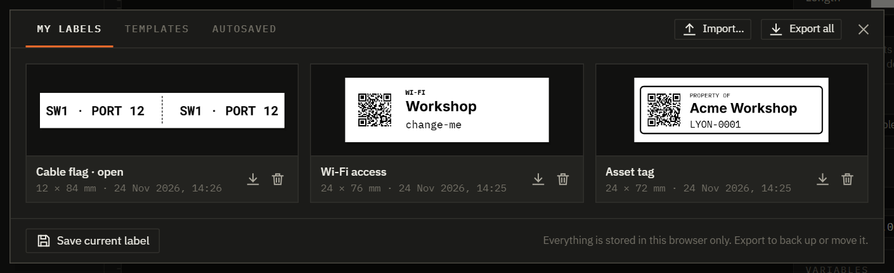
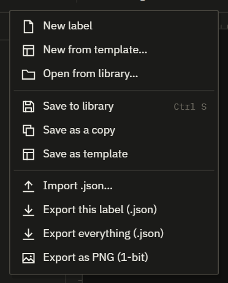
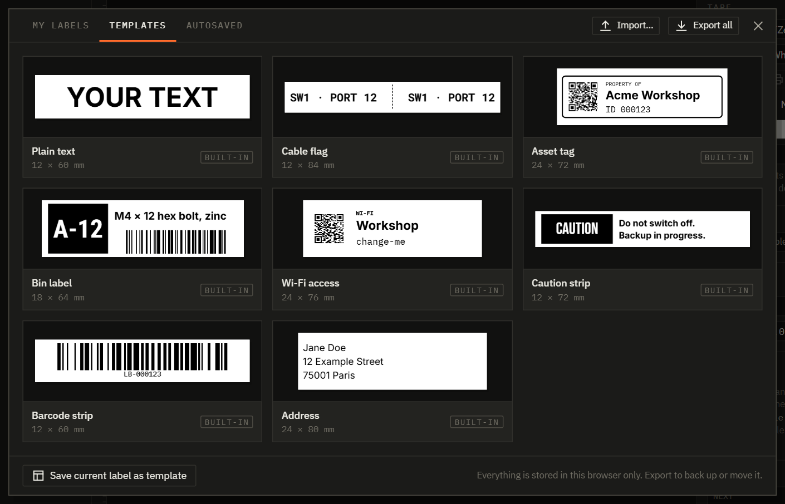
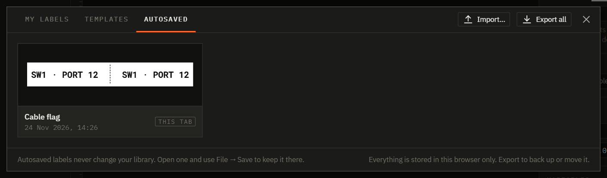
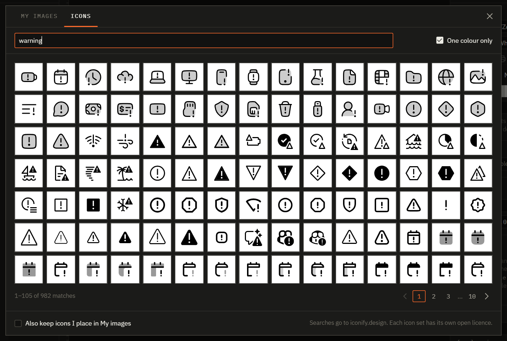

# Library

Everything is stored in this browser. There are three kinds of saved work, shown as
tabs in the **Library** dialog (top bar).

## Autosave

Every change is saved automatically as the **working copy** of the tab you are in. The
top bar shows when it was last saved.

- Each browser tab has its own working copy, so several labels can be open side by side.
- Reloading a tab brings its label back.
- A new tab picks up the most recent working copy that no open tab is using.
- Autosave never changes a label saved in the library. If the open label is in the
  library and has newer changes, the top bar says **library copy not updated**.

## My labels

Named labels you chose to keep.

- **File → Save to library** (Ctrl+S) saves the open label, or updates its library copy.
- **File → Save as a copy** saves it as a new label.
- Click a card to open it. Middle-click opens it in a new browser tab.
- The icons on a card export it as a `.json` file or delete it.

## Templates

Starting points for new labels. Built-in templates are marked *Built-in*; your own are
marked *yours*.

- Click a template to start a new label from it. The template itself is not changed.
- **Save current label as template** (in this tab) or **File → Save as template** adds
  the open label to your templates.

## Autosaved

Working copies kept by autosave: one per open tab, plus work that was set aside.

- **This tab** is the label you are working on.
- **Other tab** is open in another tab; clicking it opens a copy here.
- Anything else is from a closed tab, or was set aside when you opened another label
  with unsaved changes. Click to bring it into this tab, or delete it.
- Working copies from tabs closed more than 30 days ago are removed.

To keep an autosaved label for good, open it and save it to the library.

## Images

The **Image** tool in the left rail has two sources: a file, or **My images**, a library
of pictures and SVG files stored in this browser.

- **Add images…** stores files in the library. SVG files stay vector, so they print
  sharp at any size.
- Click a picture, then click or drag on the label to place it.
- **Keep** in an image's settings saves a picture already on a label to the library.

### Icons

The **Icons** tool searches the open-source sets collected by Iconify as you type.
*One colour only* leaves out multi-colour sets such as emoji, which can only print as a
dither. Tick *Also keep icons I place in My images* to build up your own set. Each icon
set has its own open licence.

## Moving and backing up

| Action | Where | What it does |
|---|---|---|
| Export this label | File menu | One label as `.json` |
| Export a saved label or template | The download icon on its card | One `.json` file |
| Export everything | File menu, or **Export all** in the library | All saved labels, your templates and your images in one file |
| Import | File menu, or **Import…** in the library | Reads any of the files above |
| Export as PNG | File menu | The label as the 1-bit image the printer receives |

Export everything saves the library as it is. Save the open label first (Ctrl+S) if
you want its latest changes included.

Clearing the browser's site data deletes the library, so export a backup now and then.
