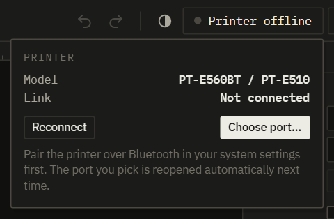
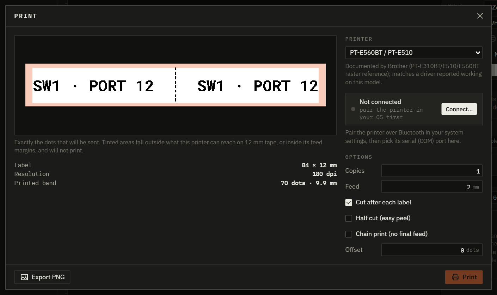

# Printing

Printing needs Chrome, Edge or Opera on a desktop computer. The app talks to the
printer directly over a serial port; a Bluetooth printer paired with the computer
appears as one.

## Connecting

1. Pair the printer over Bluetooth in your operating system's settings.
2. Click the printer control in the top bar (**Printer offline**).
3. Click **Choose port…** and pick the printer's serial (COM) port.

The port you pick is reopened automatically the next time you open the app. If the
printer is off or out of range it stays *offline*; switch it on and use **Reconnect**.
**Disconnect** also turns off the automatic reconnect until you connect again.

## The printer control

Once connected it shows the model and the loaded tape, for example `PT-E560BT · 12 mm`.

- It turns red when the loaded tape is a different width from the label, or when the
  printer reports a problem such as an open cover or no cassette.
- The panel then offers **Switch the label to … mm**.
- When the printer reports the cassette's colours, the panel shows them and can apply
  them to the preview.
- The app asks the printer what is loaded every 20 seconds, so swapping the cassette
  shows up on its own.
- The port is only opened for a status check or a print and closed straight after, so
  several tabs can share one printer. Only the tab you are looking at checks the status;
  if two tabs want the printer at once, one waits for the other.

**Match the printer**, in the label settings, sets the label's width and colours to the
loaded cassette in one click.

## Printing a label

Press **Print**.

- The preview shows exactly the dots that will be sent. Tinted areas are outside what
  the printer can reach on this tape, or inside its feed margins, and will not print.
- **Copies:** how many to print. A label using `{seq}` gets the next number on each copy.
- **Feed:** blank tape before and after the printed area.
- **Cut after each label**, **Half cut** and **Chain print** depend on the printer.
- **Offset:** shifts the print across the tape if it sits off-centre.
- **Export PNG** saves the 1-bit image instead of printing.

If the loaded tape does not match the label, the dialog says so and offers *Print anyway*.

## Supported printers

| Profile | Status |
|---|---|
| PT-E560BT / PT-E510 | Follows Brother's raster reference for these models. |
| PT-P710BT (Cube Plus) | Follows Brother's reference; matches several open-source drivers. |
| PT-P300BT (Cube) | Unverified: based on community reverse-engineering. |
| PT-P910BT (Cube XP) | Unverified: sources disagree on vertical alignment; use Offset if needed. |
| Other 180 dpi P-touch (128-pin) | Generic profile for PT-P700 / P750W / E550W / H500-class printers. |

Choose the profile in the print dialog. If your printer is not listed, the generic
profile is the one to try.

## Troubleshooting

- **No port to choose:** the printer is not paired, or the browser has no Web Serial.
- **Connected but no status:** the port opened but the printer did not answer. Check it
  is switched on, then **Refresh** in the printer panel.
- **Print is off-centre across the tape:** adjust **Offset** in the print dialog.
- **A third-party cassette reports the wrong colour:** the printer reads the colour
  from holes in the cassette. The preview colours can be set by hand in the label settings.
