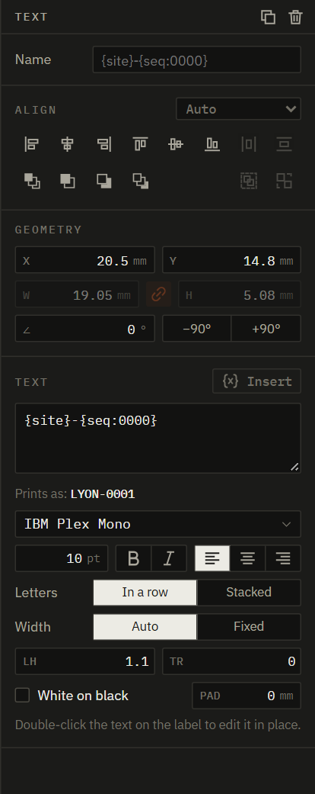
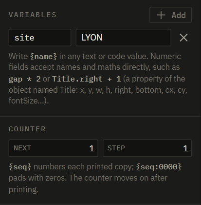

# Variables

Text between braces is replaced when the label is drawn and printed. `{site}-{seq:0000}`
prints as `LYON-0001`.

Macros work in **text**, **table cells** and **code values** (the content of a QR code
or barcode). The line *Prints as* under the text box shows the result.

## Defining variables

Deselect everything to show the label settings, then use **Add** under *Variables*.
Give each one a name and a value.

Write `{name}` wherever you want the value. The **Insert** button above a text box
lists the variables, the counter and the date macros so you don't have to type them.

A variable's value can itself contain macros.

## Built-in names

| Macro | Result |
|---|---|
| `{seq}` | The counter (see below). |
| `{date}` | Today's date, as `2026-11-24`. |
| `{time}` | The time, as `14:30`. |
| `{now}` | Same as `{date}`; use a format to show the time as well. |

## The counter

`{seq}` numbers each printed copy. Under *Counter* in the label settings:

- **Next** is the value shown now and the first one printed.
- **Step** is added for every copy.

Printing 5 copies with Next = 1 prints 1 to 5, and Next becomes 6 afterwards.

## Formats

Add a colon and a format after the name.

| You write | You get |
|---|---|
| `{seq:0000}` | `0007`: padded with zeros to four digits |
| `{seq:000}` | `007` |
| `{price:0.00}` | `12.50`: two decimals |
| `{date:dd/MM/yyyy}` | `24/11/2026` |
| `{date:MMM yyyy}` | `Nov 2026` |
| `{now:HH:mm}` | `14:30` |

## Maths and functions

Arithmetic works inside the braces: `+ - * /` and parentheses.

| You write | You get |
|---|---|
| `{seq + 100}` | The counter plus 100 |
| `{seq + 100:0000}` | The same, zero padded |
| `{price * 1.2:0.00}` | A price with 20% added, two decimals |
| `{upper(site)}` | The value in capitals |
| `{lower(site)}` | The value in lower case |
| `{pad(seq, 5)}` | Padded to 5 characters with zeros |
| `{pad(seq, 5, '*')}` | Padded with another character |
| `{round(width / 3, 1)}` | Rounded to one decimal |
| `{len(site)}` | Number of characters |
| `{min(a, b)}` / `{max(a, b)}` | Smallest / largest |

`+` joins text when either side is not a number: `{site + '-' + seq}`.

## Referring to other objects

Give an object a **Name** (top of its settings), and other objects can use it.

- `{Title}` is the text of the object named Title (or the value of a code).
- `{Title.w}` is one of its properties.

| Property | Meaning |
|---|---|
| `x`, `y` | Left and top, in mm |
| `w`, `h` | Width and height |
| `right`, `bottom` | Right and bottom edges |
| `cx`, `cy` | Centre |
| `fontSize`, `rotation`… | Any numeric setting of the object |

## Numeric fields driven by an expression

Most numeric fields in an object's settings accept an expression instead of a number.
Type it without braces:

- `Title.right + 2` in **X** keeps an object 2 mm to the right of the object named Title.
- `gap * 2` uses a variable named gap.

A field driven by an expression is highlighted and shows `=` before the expression.
Type a plain number to make it an ordinary value again.

## Notes

- Names are case-insensitive and can contain letters, digits and `_`.
- A macro the app cannot work out is left in the text as written, so a typo is easy to spot.
- To print a literal brace, double it: `{{` and `}}`.
